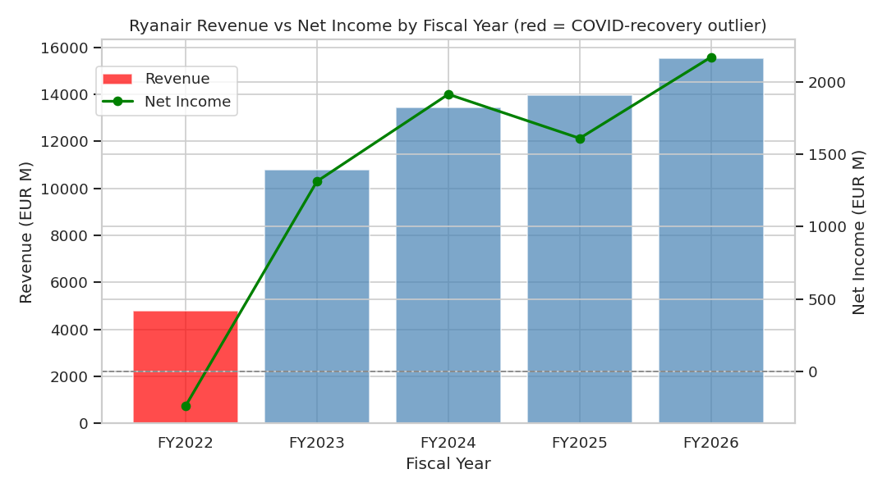

# Ryanair Financial Analytics Pipeline

An end-to-end data analytics pipeline — Python for data extraction, cleaning, exploratory analysis, and regression modeling; Tableau for an interactive, branded dashboard — applied to Ryanair Holdings plc (NASDAQ: RYAAY), Europe's largest airline by passenger volume.

Built following the 6-stage Business Analytics Workflow: **Business Question → Data Sources → Prepare → Mine/Analyze → Insight → Decision/Action**.

## Business Question

How has Ryanair's financial performance evolved in recent years, and what does this reveal about the sustainability of its low-cost carrier model?

## Live Dashboard

**[View the interactive Tableau dashboard →](https://public.tableau.com/app/profile/muhammad.abbas.rao/viz/RyanairFinancialPerformanceDashboard/RyanairFinancialDashboard)**


*(Replace this with a full dashboard screenshot — see note at the bottom of this file.)*

## Key Findings

- **Revenue grew from €10,775M to €15,544M** over FY2023–FY2026 (post-COVID-recovery years), a consistent trend (R² = 0.93), not a noisy bounce.
- **Return on Equity stabilized in the 21–25% range** every year since the FY2022 COVID-era loss — three straight years of consistent profitability, not a one-off spike.
- **Debt-to-equity fell from 0.92 to 0.15** over the same period — Ryanair deleveraged aggressively while still growing revenue.
- A regression of operating margin on debt-to-equity shows a negative relationship (coefficient -23.64, R² = 0.60), but with only 5 fiscal years of data this does **not** reach standard statistical significance — a real, honest limitation of company-level financial time series, documented rather than glossed over.
- Linear trend models forecast **FY2027 revenue near €17.1B** and a **2027 average stock price near $55.87** — both explicitly framed as trend extrapolations, not guarantees.

## Repository Structure

```
ryanair-financial-analytics-pipeline/
├── data/
│   ├── raw/                  # As-extracted source data (SEC filings via stockanalysis.com, macrotrends)
│   └── processed/            # Cleaned, merged, feature-engineered data ready for analysis
├── notebooks/
│   ├── 01_data_cleaning.ipynb            # Prepare stage: types, outlier flagging, merges, ratios
│   ├── 02_exploratory_data_analysis.ipynb # Trend charts, correlation heatmap
│   └── 03_regression_modeling.ipynb       # Trend regression, forecasting, driver analysis
├── reports/
│   └── figures/               # All exported chart images from the notebooks above
├── tableau/
│   └── ryanair_financial_performance_dashboard.twbx  # Full packaged workbook (opens in Tableau Public/Desktop)
└── requirements.txt
```

## Methodology Notes

- **Data source**: Ryanair's own SEC filings (10-K/10-Q), accessed via stockanalysis.com (S&P Global Market Intelligence / Fiscal.ai) and macrotrends.net for stock price history. Not a live API feed — a point-in-time extraction.
- **FY2022 is flagged, not dropped**: it's a genuine COVID-recovery year (net loss), kept in the data and marked with an `is_outlier_year` column so downstream analysis can include or exclude it deliberately.
- **Modeling choice**: plain `scikit-learn` linear regression, not deep learning — with 5 annual data points, a neural network would memorize rather than learn. Model outputs are reported with R² and treated as descriptive trends, not production forecasts.
- **Sample size honesty**: every statistical claim in this project is reported alongside its real limitation (n=5 fiscal years for most company financials). This is a deliberate choice to model good analytical practice over overstating confidence.

## Tech Stack

Python (pandas, NumPy, scikit-learn, matplotlib, seaborn) · Tableau Public · Jupyter

## Reproducing This Project

```bash
pip install -r requirements.txt
jupyter notebook notebooks/01_data_cleaning.ipynb
```

Run the three notebooks in order (01 → 02 → 03) — each writes its outputs to `data/processed/` or `reports/figures/`, which the next notebook reads from.

To view the dashboard, open `tableau/ryanair_financial_performance_dashboard.twbx` in [Tableau Public](https://www.tableau.com/products/public) (free) or Tableau Desktop — it's a fully packaged workbook with all data embedded, no additional setup needed.

## Author

Muhammad Abbas Rao — BS Business Analytics, FAST National University, Karachi
